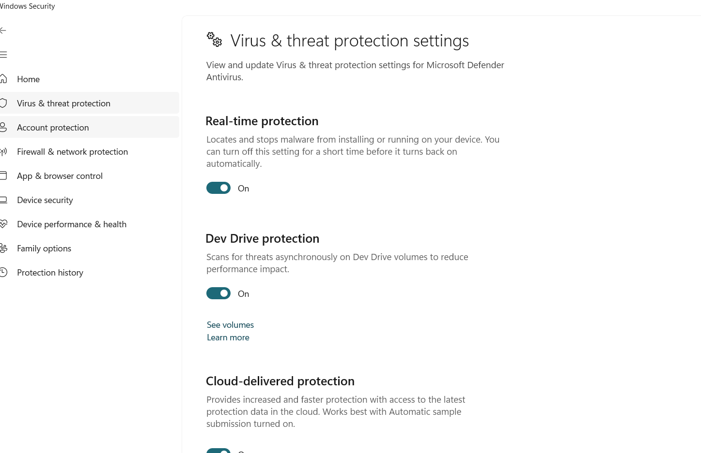
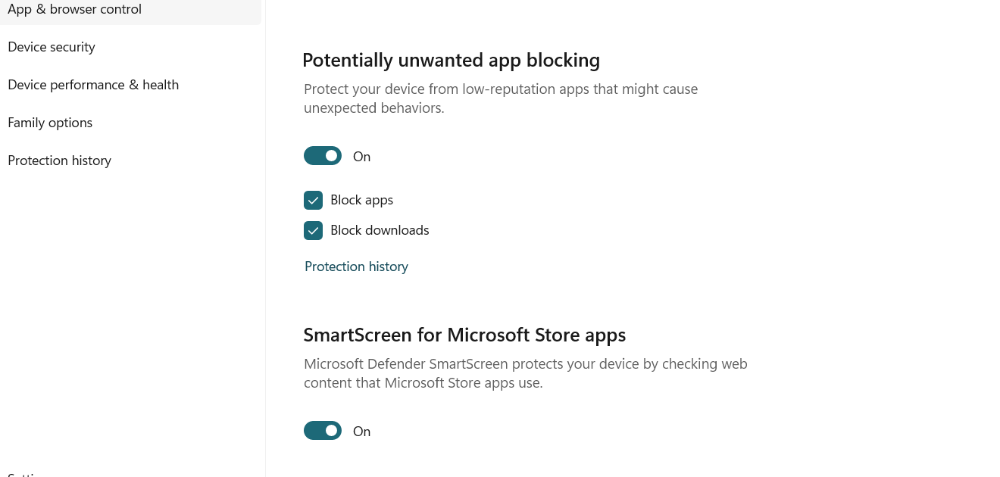
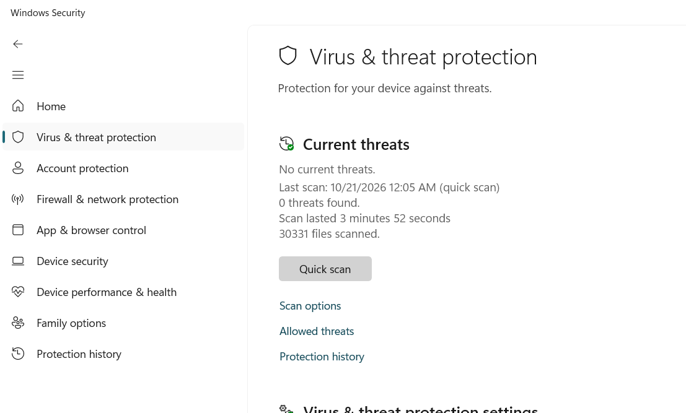
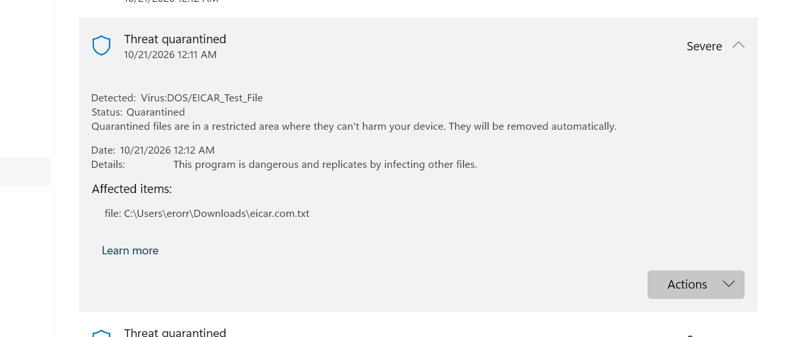
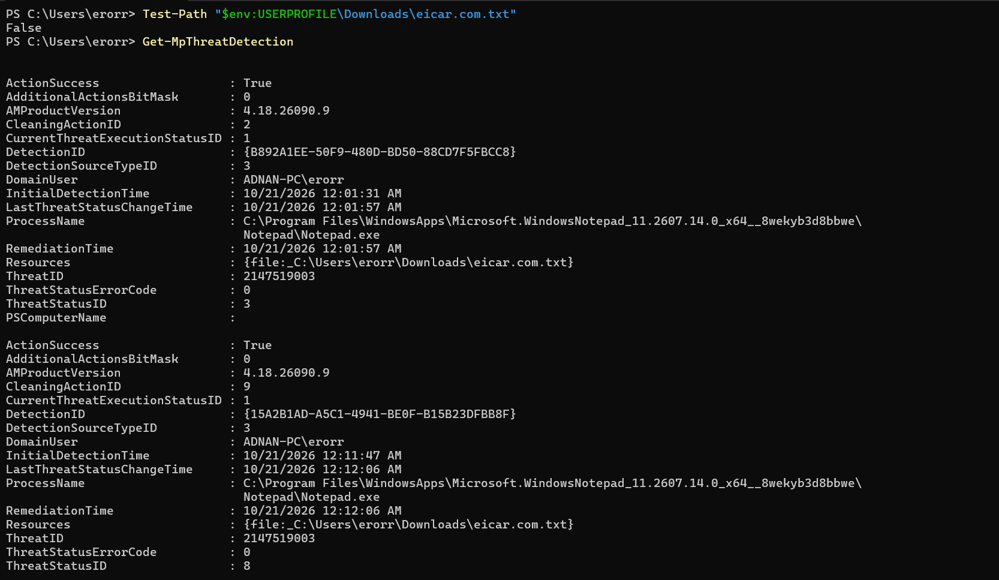
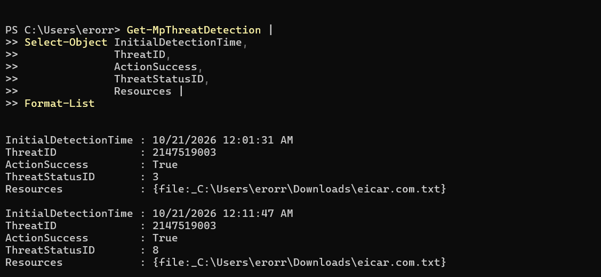
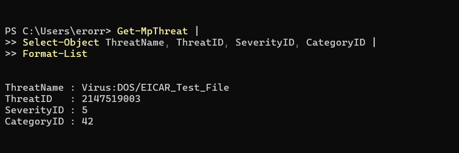

# Microsoft Defender Antivirus — Detection & Remediation Lab

## Project overview
This hands-on lab documents a controlled Microsoft Defender Antivirus detection test using the harmless EICAR antivirus test artifact. It covers protection-setting review, detection-history review, PowerShell investigation, and verification that the test file was absent from its original path.

**Environment:** Windows  
**Tools:** Microsoft Defender Antivirus, Windows Security, PowerShell  
**Test artifact:** EICAR test file (harmless; not real malware)

## Objectives
- Review Defender Antivirus protection settings.
- Validate antivirus detection with the EICAR test artifact.
- Review Windows Security Protection History.
- Inspect Defender detection records with PowerShell.
- Verify the original test-file path and document results.

## Workflow and findings

### 1. Review protection settings
The captured settings screens show real-time protection, cloud-delivered protection, and automatic sample submission settings. A separate screen shows potentially unwanted app blocking, including Block apps and Block downloads, enabled.

### 2. Review the quick scan
The captured Windows Security screen reports **0 threats found** and **30,331 files scanned** for the quick scan shown. This result applies only to that scan at that time; it is not a guarantee that a device is completely threat-free.

### 3. Validate detection with EICAR
Windows Security Protection History shows the detection name:

`Virus:DOS/EICAR_Test_File`

The recorded path was:

`C:\Users\error\Downloads\eicar.com.txt`

EICAR is a harmless, standardized antivirus test artifact. It is used to validate antivirus response without using real malware.

### 4. Investigate with PowerShell
The captured PowerShell output includes these commands:

```powershell
Test-Path "$env:USERPROFILE\Downloads\eicar.com.txt"
```

The result was `False`, meaning the file was absent from that original path at the time of the check.

```powershell
Get-MpThreatDetection |
Select-Object InitialDetectionTime,
              ThreatID,
              ActionSuccess,
              ThreatStatusID,
              Resources |
Format-List
```

The reviewed output showed two detection records for threat ID `2147519003`; both showed `ActionSuccess : True`. The records are separate entries for the same test artifact, not evidence of two different malware samples.

```powershell
Get-MpThreat |
Select-Object ThreatName, ThreatID, SeverityID, CategoryID |
Format-List
```

The output identified `Virus:DOS/EICAR_Test_File` with threat ID `2147519003`.

## Evidence screenshots

### 1. Defender protection settings


### 2. Potentially unwanted app blocking


### 3. Quick scan result


### 4. Protection History — quarantined test artifact


### 5. PowerShell — file-path check and detection records


### 6. PowerShell — selected detection fields


### 7. PowerShell — threat details


## Skills demonstrated
- Endpoint protection configuration review
- Antivirus detection validation
- Security alert triage
- PowerShell-based threat investigation
- Remediation verification
- Evidence collection and technical documentation

## Limitations
This was a local Windows Defender Antivirus lab using a harmless EICAR test artifact. It does not demonstrate detection of real malware, nor does it demonstrate enterprise Microsoft Defender for Endpoint EDR, centralized incident management, or advanced hunting.

## Conclusion
The lab demonstrates a basic endpoint-security workflow: review protection settings, run a controlled detection test, inspect Defender records, verify the original file path, and document the evidence.
